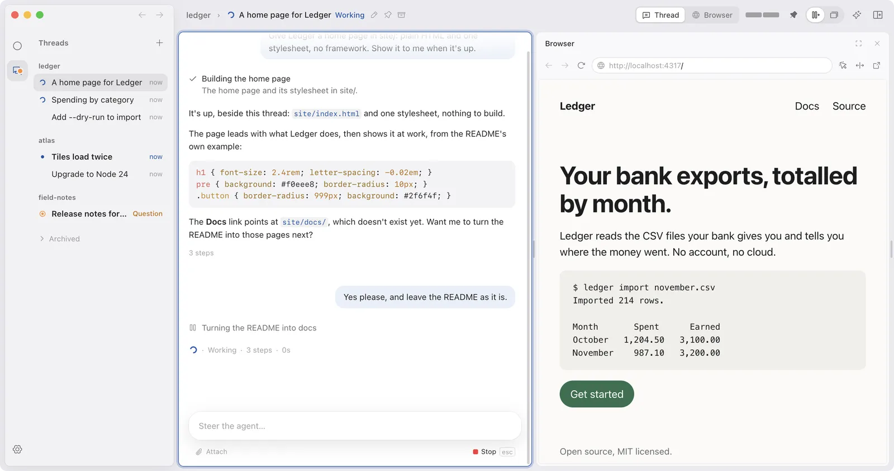

<p align="center"></p>

# Superego

A desktop app for running coding agents, with a daemon on each machine that keeps them running when the app is closed.
The same window works in a browser and on a phone.

- **Download:** [the latest release](https://github.com/githubnext/superego/releases/latest) (macOS, Apple Silicon)
- **Docs:** [githubnext.github.io/superego](https://githubnext.github.io/superego/docs/)

## Develop

```sh
pnpm install
pnpm dev          # the app from source; its daemon lives in ~/.superego
pnpm typecheck
pnpm test
pnpm smoke        # the app end to end, headless
```

[AGENTS.md](AGENTS.md) has the house rules and which checks to run when. [docs/development.md](docs/development.md)
covers the repository's layout and the rest of the commands; [docs/design.md](docs/design.md) the architecture;
[docs/releasing.md](docs/releasing.md) releases.

## Licence

[MIT](LICENSE)
