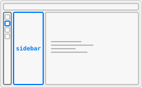
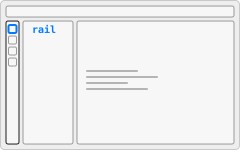
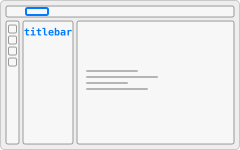
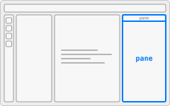
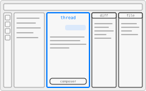
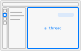
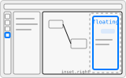
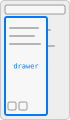
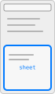

# How the window is put together

The window is a few fixed **places**, and **views** that extensions put in them. The main area shows one thing at a
time: a **thread** (with its **panes** beside it), or a **space**. This page names each part, what goes where, and
who may put it there. For the API, see [The window](../packages/cli/skill/window.md) and [The UI half](../packages/cli/skill/ui.md).

<figure class="wide">

<figcaption>The window, wide. The main area shows a thread or a space; around it are the places views go in.</figcaption>
</figure>

## Places

A place is a part of the window that views go in. The layout decides which view goes where: each view's `default`,
then whatever you moved (`~/.superego/layout.json`, or a right-click on the view).

<figure class="steps">

<figcaption>sidebar · rail · titlebar · header · beside · pane</figcaption>
</figure>

- **sidebar**: a button in the rail, and the **sidebar** while it's the open one. Threads is a sidebar, and so are Staff
  and Notes. Only one sidebar is open at a time; its button hides or shows the sidebar.
- **rail**: a button in the rail that isn't a sidebar (Ask Ego).
- **titlebar**: the start of the title bar, standing in for a sidebar when there's none (the thread picker).
- **header**: right of the thread's title (its model, a chip).
- **beside**: a column right of the thread (thread details, ⌘I).
- **pane**: the thread's pane menu. Such a view opens as a pane (below).

`sidebar`, `rail` and `titlebar` are the **window's** places: there's one of each whatever thread is shown. `header`,
`beside` and `pane` are a **thread's**: what they show is about the thread shown, and a profile's views appear there only
in that profile's threads.

## Threads and panes

The main area usually shows a thread: its transcript and composer, and its **panes** in columns to its right. A pane is
opened *in a thread*, with params (a file, a diff, a web page); a thread can have as many as it likes, and they're kept
with it. The agent opens them too (`pane_open`).

<figure class="wide">

<figcaption>A thread, a diff pane and a file pane. Switch threads and you switch panes.</figcaption>
</figure>

## Views, panes and spaces

Three ways an extension shows something. They differ in how many there are and who decides where they go.

<figure class="steps">

<figcaption>A view is placed. A pane is opened in a thread. A space is opened in the window.</figcaption>
</figure>

| | How many | Where | Opened by |
|---|---|---|---|
| **View** | one, by its id | where the layout puts it (any place it fits) | being placed: it's simply there |
| **Pane** | any number, each with params | beside the thread it belongs to | `pane.open`, the pane menu, the agent's `pane_open`, a file link |
| **Space** | any number, each with params | the main area, instead of the thread | `space.open`, a link its scheme claims (`note:…`), its sidebar's list |

A view is something like *the* thread list or *the* Staff board: there's one, and you choose where it lives. A pane or a
space is something like *a* file or *a* note: you open as many as you need, and each is what its params say.

## Spaces

A space fills the main area, where a thread otherwise shows: a notes page, a canvas. Back and forward go through
spaces as through threads, and picking a thread in the sidebar leaves the space for it.

<figure class="steps">

<figcaption>A thread, then <code>note:a</code> from a link in it, then <code>note:b</code> linked from a. Back returns to a, then to the thread.</figcaption>
</figure>

Each space has **its own thread**, one per space (a kind with its params), which the window remembers. Until there
is one, the column offers *Ask about this…*: sending starts a thread on the space's profile, told what you have open,
and docks it. It's listed in the sidebar like any other thread; ↗ opens it as the thread, ✕ undocks it. The title bar's
button shows or hides it. A space picks how its thread sits:

<figure class="steps">

<figcaption>Docked, a column beside it (a notes page). Floating, a card over its right side (a canvas, which wants the room). The space is told how much the card covers, to keep its own controls clear.</figcaption>
</figure>

## Sidebars and spaces together

A sidebar and a space are different places, and an app like Notes uses both: its **sidebar** is the list of notes, and each
note it opens is a **space** in the main area, with a thread docked beside it.

<figure class="wide">

<figcaption>Notes. The rail's third button is its sidebar; <code>notes.list</code> fills the sidebar; a click opens <code>notes.page</code> with <code>{ name }</code>; its thread is docked on the right.</figcaption>
</figure>

So a sidebar is *where you pick something*, and a space is *the thing you picked, filling the window*. Threads work the
same way: the Threads sidebar lists them, and the one you pick fills the main area.

## Who may put what where

What an extension draws comes either as **code** (a UI half: React components) or as **data** (a daemon half's data
view: blocks the window draws itself, so no code of the extension's runs in the window).

| Who | Window places (sidebar, rail, titlebar) | Thread places (header, beside, pane) | Spaces |
|---|---|---|---|
| The app's bundled extensions | yes | yes, in every thread | yes |
| A **global** profile of yours (`global: true`) | yes | yes, in every thread | yes |
| Any other profile of yours | data views only | yes, in its own threads | no |
| A project's profile | no | yes, in its own threads | no |

A global profile is part of the app rather than of its threads: the daemon loads it when it starts, and the window
installs its UI as the app's. Notes and Canvas are global profiles. A remote machine's profile UI still asks you before
its code runs in your window.

## On a phone

There's no rail and no title bar. The open sidebar is a **drawer** over the thread, with the other sidebars at its foot. A
thread's title opens its **sheet**, holding what the title bar and the column beside would. A space fills the screen,
and its thread opens as the thread.

<figure class="steps phones">

<figcaption>The drawer · the thread's sheet · a space</figcaption>
</figure>

## Words

- **Place**: a part of the window views go in: `sidebar`, `rail`, `titlebar`, `drawer` (the window's); `header`,
  `beside`, `pane` (a thread's).
- **View**: something an extension draws, by id, that the layout puts in places.
- **Layout**: where each view goes: views' defaults, then your changes (`layout.json`).
- **Sidebar**: a rail button and the panel it opens beside the main area.
- **Pane**: a column beside a thread, opened in it with params.
- **Space**: a view that fills the main area, opened with params, with a thread of its own.
- **Slot**: a spot inside another part (above the composer, after a thread's title in the sidebar) that extensions add
  to, in order; not moved by the layout.
- **UI half / daemon half**: an extension's code for the window, and for its machine.
- **Data view**: a view drawn from blocks a daemon half sends, with no code in the window.
- **Global profile**: one of your profiles that's part of the app, not only of its threads.
