# How the window is put together

The window has fixed **places**, and extensions put **views** in them. The main area shows a **thread** (with its
**panes** beside it) or a **space**. For the API, see [The window](../packages/cli/skill/window.md) and
[The UI half](../packages/cli/skill/ui.md).

<figure class="wide">
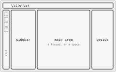
<figcaption>The main area shows a thread or a space; around it are the places views go in.</figcaption>
</figure>

## Places

Each view goes where its `default` says, unless you moved it (right-click it, or edit `~/.superego/layout.json`).

<figure class="steps">

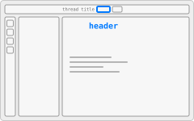
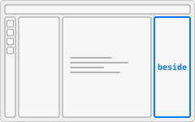

<figcaption>sidebar · rail · titlebar · header · beside · pane</figcaption>
</figure>

| Place | Is | Example | Whose |
|---|---|---|---|
| `sidebar` | a rail button, and the sidebar it opens (one open at a time) | Threads, Staff, Notes | the window's |
| `rail` | a rail button that isn't a sidebar | Ask Ego | the window's |
| `titlebar` | the title bar's start, standing in when there's no sidebar | the thread picker | the window's |
| `header` | right of the thread's title | the model chip | the thread's |
| `beside` | a column right of the thread | thread details (`⌘I`) | the thread's |
| `pane` | the thread's pane menu; the view opens as a pane | Changes | the thread's |

The window's places are the same whatever thread is shown. A thread's places show views about that thread, and a
profile's views only in that profile's threads.

## Threads and panes

A pane is opened *in a thread*, with params (a file, a diff, a web page), and kept with it. A thread can have any
number. Switch threads and you switch panes.

<figure class="wide">

<figcaption>A thread, a diff pane and a file pane.</figcaption>
</figure>

## Views, panes and spaces

<figure class="steps">
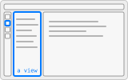
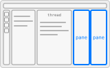
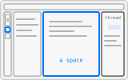
<figcaption>A view is placed. A pane is opened in a thread. A space is opened in the window.</figcaption>
</figure>

| | How many | Where | Opened by |
|---|---|---|---|
| **View** | one, by its id | where the layout puts it | being placed |
| **Pane** | any number, each with params | beside its thread | `pane.open`, the pane menu, the agent's `pane_open`, a file link |
| **Space** | any number, each with params | the main area, instead of the thread | `space.open`, a link of its scheme (`note:…`), its sidebar's list |

*The* thread list is a view. *A* file is a pane; *a* note is a space.

## Spaces

A space fills the main area: a notes page, a canvas. Back and forward go through spaces as through threads; picking a
thread leaves the space.

<figure class="steps">

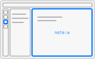

<figcaption>A thread, then <code>note:a</code> from a link in it, then <code>note:b</code> linked from a. Back returns to a, then to the thread.</figcaption>
</figure>

Each space has **its own thread**. Until it has one, the column offers *Ask about this…*: sending starts a thread on
the space's profile, told what you have open. It's listed in the sidebar like any other; ↗ opens it as the thread,
✕ undocks it, and the title bar's button shows or hides it.

<figure class="steps">
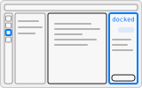

<figcaption>Docked: a column beside it (a notes page). Floating: a card over its right side (a canvas).</figcaption>
</figure>

## Sidebars and spaces together

A sidebar is where you pick something; a space is the thing you picked. Notes uses both: its sidebar lists notes, and
each note opens as a space with a thread docked beside it.

<figure class="wide">
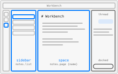
<figcaption>Notes. The rail's third button is its sidebar; <code>notes.list</code> fills the sidebar; a click opens <code>notes.page</code> with <code>{ name }</code>; its thread is docked on the right.</figcaption>
</figure>

## Who may put what where

An extension draws with **code** (a UI half: React components) or **data** (a daemon half's data view: blocks the
window draws, so none of the extension's code runs in the window).

| Who | Window places (sidebar, rail, titlebar) | Thread places (header, beside, pane) | Spaces |
|---|---|---|---|
| The app's bundled extensions | yes | yes, in every thread | yes |
| A **global** profile of yours (`global: true`) | yes | yes, in every thread | yes |
| Any other profile of yours | data views only | yes, in its own threads | no |
| A project's profile | its spaces only, while you're in the project | yes, in its own threads | yes, its project's |

Where a profile lives says how far it reaches; there's no key to set. A global profile is part of the app: the daemon
loads it at start, and the window installs its UI as the app's. Notes and Canvas are global profiles. A project's
profile (in the repo's `.superego/profiles`) is part of its project: its spaces are the project's, and nothing it draws
reaches outside it. A remote machine's profile UI still asks before its code runs in your window, and a project's runs
only once allowed (`superego profile allow`), again after its files change.

### A project's spaces

Under the project's heading in Threads, each kind is a row (▦ and its title) above its threads. In the rail, while
you're *in* the project (one of its threads selected, or one of its spaces open), they're a group of their own after
the app's buttons, between lines, each lit while open; leave for another project and the group goes. On a phone,
they're at the drawer's foot. Their links open them only from the project's threads and spaces. Of two of the
project's profiles declaring one kind, its default profile's wins. A thread docked to one starts in the project's
folder. A project shows once it has a thread, and its spaces with it.

<figure class="wide">
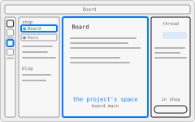
<figcaption>In the shop: Board and Docs are a group in the rail, between lines, and rows under its heading above its threads. Board is open.</figcaption>
</figure>

## On a phone

No rail, no title bar. The open sidebar is a **drawer** over the thread, with the other sidebars at its foot. A
thread's title opens its **sheet**: what the title bar and the column beside would hold. A space fills the screen, and
its thread opens as the thread.

<figure class="steps phones">

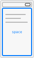
<figcaption>The drawer · the thread's sheet · a space</figcaption>
</figure>

## Words

| Word | Means |
|---|---|
| **Place** | a part of the window views go in: `sidebar`, `rail`, `titlebar`, `drawer` (the window's); `header`, `beside`, `pane` (a thread's) |
| **View** | something an extension draws, by id, that the layout places |
| **Layout** | where each view goes: views' defaults, then your changes (`layout.json`) |
| **Sidebar** | a rail button and the panel it opens |
| **Pane** | a column beside a thread, opened in it with params |
| **Space** | a view that fills the main area, opened with params, with a thread of its own |
| **Slot** | a spot inside another part (above the message box, after a thread's title in the sidebar) that extensions add to; the layout doesn't move it |
| **UI half / daemon half** | an extension's code for the window, and for its machine |
| **Notice** | what an extension tells you in a thread without a run (checks failed, a reminder): a card under its name, with buttons, that makes the thread unread and notifies; the agent is told it with its next turn |
| **Data view** | a view drawn from blocks a daemon half sends, with no code in the window |
| **Global profile** | one of your profiles that's part of the app, not only of its threads |
